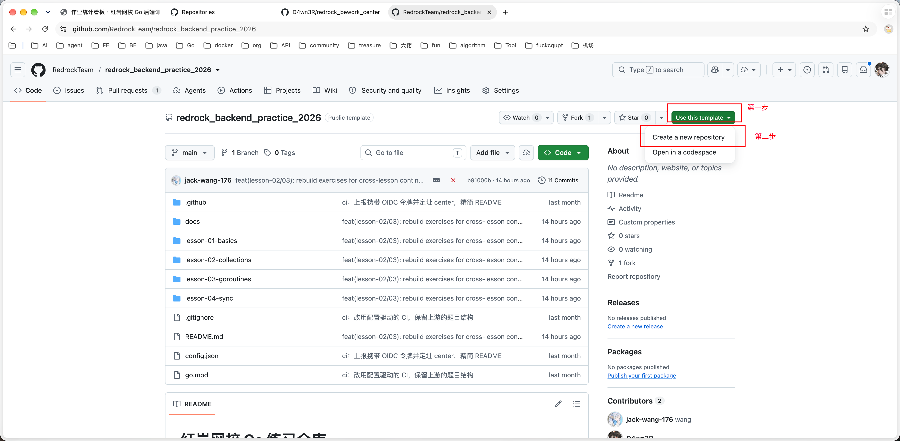
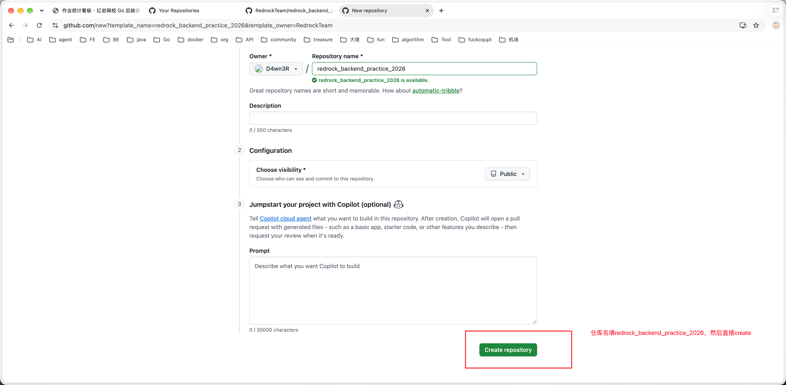
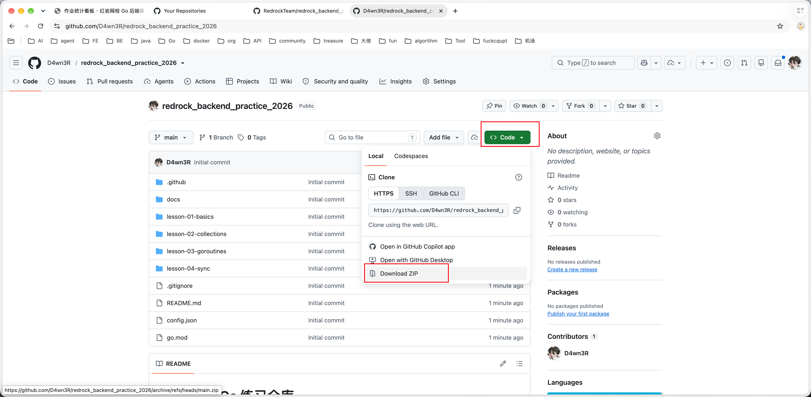
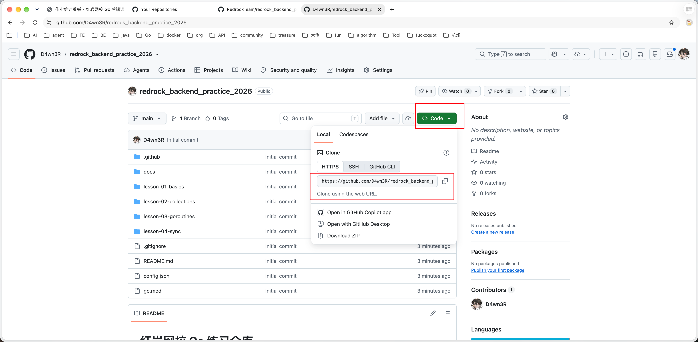

# 红岩网校 Go 练习仓库

**这是模板仓库，别在这里做题。** 点右上角「Use this template」→「Create a new repository」，复制一份到你自己的账号下，在那一份里做。

<<<<<<< HEAD
| 路径 | 内容 |
|---|---|
| `lesson-01-basics/` | 第一课：Go 基础、语法迁移、package 与 module、可见性、写测试、纠错，共 9 题 |
| `lesson-02-collections/` | 第二课：指针与数组、切片语义、map、对象与 interface，最后把共享 map 交给下一课，共 8 题 |
| `lesson-03-goroutines/` | 第三课：CPU 指令与执行、线程交错、goroutine、并发拆分，最后量出结果缺失，共 7 题 |
| `lesson-04-sync/` | 第四课：WaitGroup、Mutex/atomic、channel、可取消流水线、Once 与超时、worker pool，共 8 题 |
| `config.json` | **你要填的文件**：姓名、本次课次；中心站点地址老师已预置 |
| `.github/workflows/grade.yml` | 唯一的 workflow：校验配置 → 按课次评分 → 上报 |
| `.github/scripts/` | 评分与上报的脚本，可在本机直接运行 |
>>>>>>> eb7e90a (feat: modify test)

## 前置准备

### 用模板建出自己的仓库

访问 https://github.com/RedrockTeam/redrock_backend_practice_2026





### 把远程仓库clone到本地

这里有两种做法：
1.直接下载源码的zip压缩包，解压后移动到自己专门放代码的地方，但是需要自己绑定远程仓库


2.使用git命令


在你想要放代码的目录执行如下命令，会自动下载并绑定远程仓库（把地址里的「你的GitHub用户名」换成你自己的）：

```bash
git clone https://github.com/你的GitHub用户名/redrock_backend_practice_2026.git
```

### 完善个人信息

打开根目录的config.json：

```json
{
  "name": "张三",
  "lesson": "lesson-01-basics",
  "center": "https://homework.blog-manmu.top"
}
```

- `name` 改成你的真实名字
- `lesson` 改成这次要做的课的目录名，必须是根目录名，**括号和中文说明一个字都不能留**，否则直接报错
- `center` 不要动

## 完成题目

### 只改这几类文件

题目要求写在每道题的 `README.md` 里，它点名让你改哪个文件就改哪个。

### 一次只做一课

`config.json` 里的 `lesson` 填哪一课，CI 就只跑那一课。做完一课交一课，下一课再把 `lesson` 改过去。

### 做完一课怎么交

```bash
<<<<<<< HEAD
go test ./lesson-01-basics/...      # 先在本机确认这一课全绿
git add .
git commit -m "完成第一课"
git push
=======
go test ./...                                   # 全部课次
go test ./lesson-01-basics/...                  # 一整课
go test -v ./lesson-01-basics/test08/roster     # 一道题，带详细输出
go test -run TestSumTo ./lesson-01-basics/test02/syntax   # 一个测试函数
go test -race ./lesson-04-sync/...              # 竞态自查（CI 不跑，不计入成绩）
go vet ./...

# 在本地复现 CI 的评分过程（先填好 config.json）
python3 .github/scripts/check_config.py
python3 .github/scripts/run_go_tests.py --root lesson-01-basics
>>>>>>> eb7e90a (feat: modify test)
```

`git commit -m` 引号里随便写，是给你自己看的说明。

也可以使用GoLand/VSCode提供的GUI按钮

push 到 **main** 后 GitHub 自动跑测试并上报成绩。**其它分支和 PR 都不会触发**。第一次 `git push` 会弹窗让你登录 GitHub，授权一次即可。

### 怎么算"这题做完了"

一道题下的**所有测试都通过**，这题才算通过。看板上的完成题数就是通过了几道题。所以本机跑 `go test` 时要看到 `ok`，而不是"大部分对"。

### 提交前自查

- `go test ./lesson-0X-.../...` 全绿；
- **例外：`lesson-03` 的 test03 在第三课结束时就是红的**，它是观察题，题面写明"不要改实现，把问题带到第四课"。这一题不算你没做完；
- `config.json` 的 `lesson` 和你这次做的课一致；
- 没改过任何 `*_test.go`（除了 test07 那道题）。

## 作业汇总

**<https://homework.blog-manmu.top>** ——「排行榜」按完成题数排名（通过几题就是几分）。

想看自己每次 CI 的结果：自己仓库顶部的 **Actions** 标签页，点进最近一次运行。

## 本地测试

```bash
go test ./lesson-01-basics/...                # 跑一整课
go test -v ./lesson-01-basics/test08/roster   # 一道题，看详细输出
go test -race ./lesson-04-sync/...            # 竞态自查（CI 不计入成绩）
```

**starter 初始一定是红的**，那是题目还没做完，不是环境坏了。唯一的例外是 `lesson-03` 的 test03：它是观察题，改完前面的题它仍然是红的，这是设计好的。

## 遇到问题

- **CI 红了**：只有两种原因——`lesson` 填错，或测试没过。上传失败不会让 CI 变红。
- **成绩没出来**：上传是「尽力而为」的，失败不影响 CI；报告另存 artifact，可事后补。
- **重复 push**：同一次 commit 重复上传不会重复计分。
- **`lesson-03` 交了还是有题红**：正常，test03 是观察题，第三课结束时本就该红。

